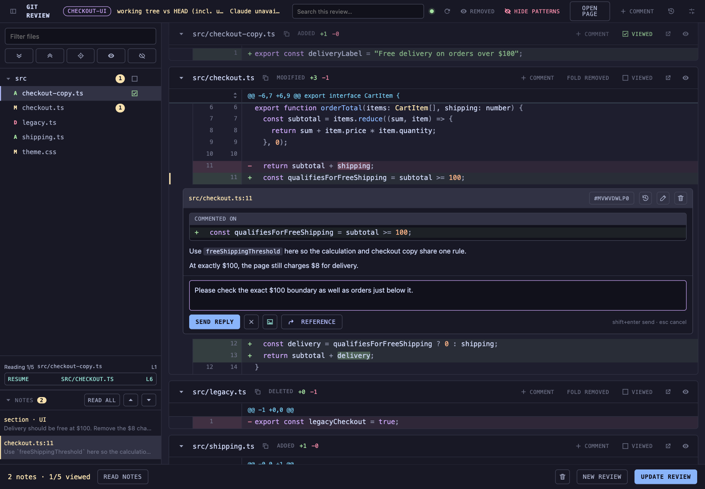
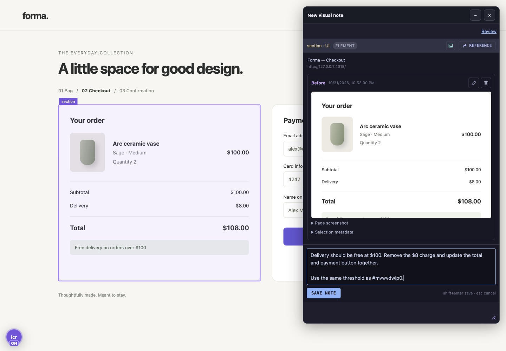

# Local Code Review

Review local Git changes and annotate a running web app. Feedback stays in Markdown, ready for any coding agent.



## Install

Download the [latest release](https://github.com/cjvnjde/local-code-review/releases/latest), extract it, and put `lcr` (`lcr.exe` on Windows) on your `PATH`. Git is required; no runtime or package install is needed.

On macOS, the binary is unsigned. After verifying the release checksum, remove quarantine if needed:

```sh
xattr -d com.apple.quarantine ./lcr
```

## Review code

Run inside a Git repository:

```sh
lcr                           # Working-tree, staged, and untracked changes vs HEAD
lcr --staged                  # Staged changes only
lcr origin/main               # Compare with origin/main, including local changes
lcr main...HEAD               # Committed branch changes since the merge base with main
lcr HEAD~3                    # Compare with three commits ago
lcr -- src/                   # Limit the review to a path
lcr --id checkout              # Continue a named review, even after commits or rebases
```

The browser opens at `http://localhost:7777`; if the port is taken, lcr prints the next available address.

1. Click a line, drag a range, or select part of a line to comment. Use a file's **Comment** or the header's **Comment** for broader feedback.
2. Save notes, then **Save review** to write `.review/review-<timestamp>.md`. The output directory is ignored by Git.
3. Ask your agent to address that file. Replies and status changes appear live; keep the conversation going under each note.

## Annotate a web app

Start your app's development server, then run:

```sh
lcr --web http://localhost:3000 --id checkout-ui
lcr --web http://localhost:3000 main...HEAD  # Visual feedback alongside an explicit diff
```



Click an element or drag an area to comment. Click the **lcr** circle to switch between annotation and normal browsing; hold **Alt** to interact temporarily. Click a capture to draw arrows, boxes, or text on it.

Visual and code notes share the same Markdown review. Captures include screenshots and element metadata; **Capture after** records the result after a fix. Requires an installed Chrome, Chromium, or Edge. [Web annotation guide →](docs/web-ui.md)

## Hand feedback to an agent

Any agent can read the review directly:

```text
Address the newest lcr review in .review/.
```

Optionally install the included skill:

```sh
npx skills add cjvnjde/local-code-review --skill apply-lcr
```

Then ask “Apply the newest lcr review” or use `/apply-lcr` if supported.

For managed sequential work with any compatible ACP agent, see [ACP connections and queue](docs/agent-connections.md):

```sh
lcr --acp /path/to/agent.json --id checkout
```

Saving a comment starts the selected agent; further comments queue until that turn ends. Queue state
survives restarts, and permissions appear in the page's **Queue** control.

For delivery into an existing session, see [Claude Code setup](docs/claude-channel.md), or attach an existing [Codex session](docs/codex-channel.md):

```sh
lcr --codex-thread <session-uuid> --id checkout
```

Once the connection is verified, **Save & ask AI** saves and sends that note immediately. Without a connection, **Save note** keeps the manual workflow.

## Other options

| Command | Purpose |
| --- | --- |
| `lcr --no-open` | Start without opening a browser |
| `lcr --port 8080` | Choose a starting port (`0` picks a free one) |
| `lcr --out .feedback` | Change the review output directory |
| `lcr --context 8` | Show more surrounding lines |
| `lcr --help` | List options and examples |
| `lcr --version` | Print the build stamp |

Unrecognized arguments pass through to `git diff`. Working-tree comparisons include untracked files; commit-to-commit ranges do not.

## Documentation

- [Review workflow and controls](docs/usage.md) — notes, images, search, history, shortcuts, and saved conversations.
- [Web annotation](docs/web-ui.md) — selection tools, drawings, before/after captures, and browser requirements.
- Agent connections: [Managed ACP queue](docs/agent-connections.md) · [Claude Code](docs/claude-channel.md) · [Codex](docs/codex-channel.md).
- [Development](docs/development.md) — run from source, checks, and standalone builds.

## License

[MIT](LICENSE)
