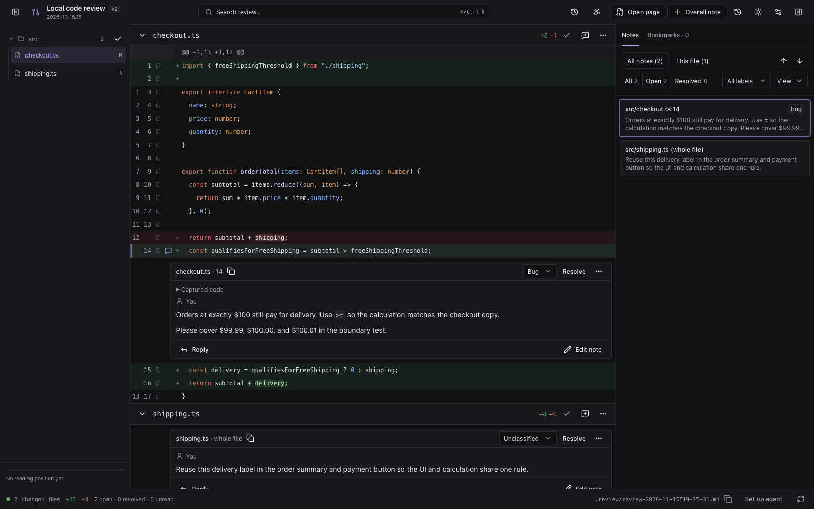
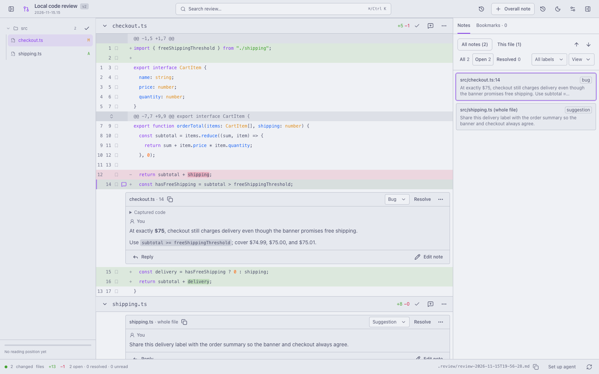
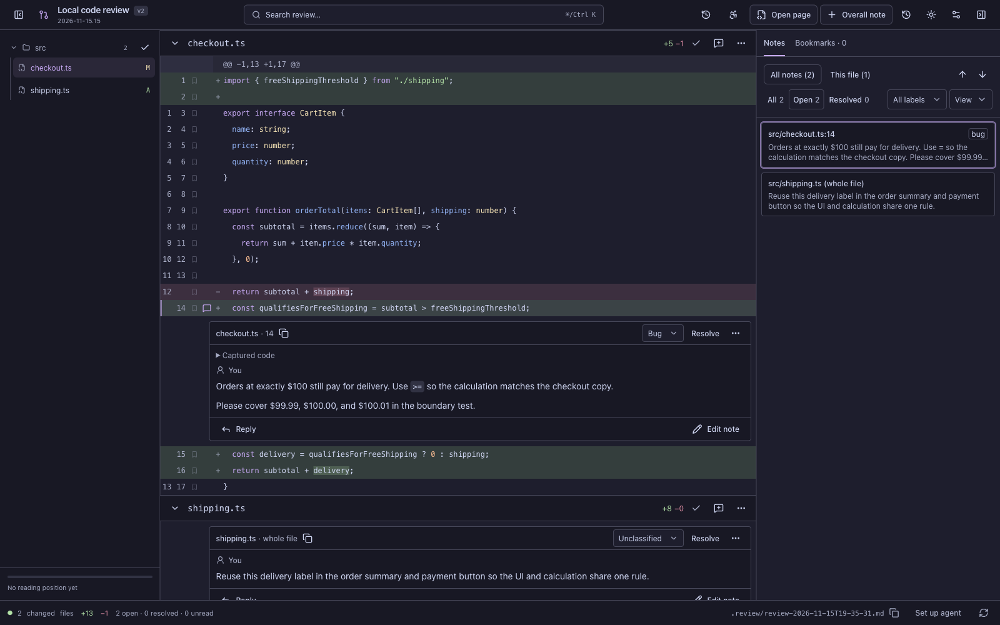
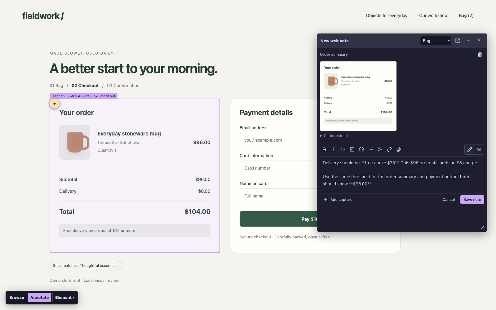

# Local Code Review

Review local Git changes and annotate a running web app. Feedback stays in Markdown, ready for any coding agent.

[](docs/local-code-review.png)

- Read continuous diffs with syntax highlighting, bookmarks, and resizable file and note panes.
- Save Markdown notes, suggested changes, images, and replies without leaving the code.
- Capture a running local app, draw on screenshots, and keep visual feedback in the same review.
- Choose Light, Dark, Catppuccin Latte, or Catppuccin Mocha—or create your own palette.
- Continue with any coding agent through review files, or connect one through ACP.

The screenshots show the React UI included in **v2.0.1**.
See [development](docs/development.md) for the library stack and architecture.

## Install

Each release contains one standalone executable, compiled and minified with Bun, with the browser assets embedded. Git is required to review code; Bun and Node.js are not required to run the downloaded executable.
`lcr licenses` prints the bundled integration licenses, third-party notices, and
the source-availability link for axe-core; it also works outside a Git repository.

### Install with mise

With [mise installed and activated in your shell](https://mise.jdx.dev/getting-started.html), install globally:

```sh
mise use -g github:cjvnjde/local-code-review@latest
lcr --version
```

Mise downloads the archive for your platform from GitHub Releases, verifies its checksum, and makes `lcr` available on your `PATH`. Releases cover Linux x64/ARM64, macOS x64/ARM64, and Windows x64. The full `github:cjvnjde/local-code-review` identifier works without a registry entry or a custom plugin. See the [mise GitHub backend](https://mise.jdx.dev/dev-tools/backends/github.html).

Update to the latest release:

```sh
mise upgrade github:cjvnjde/local-code-review
```

To pin a release for a project, run this in that project's directory:

```sh
mise use github:cjvnjde/local-code-review@2.1.0
```

This writes the version to `mise.toml`; others can run `mise install` to install it. The version is the release tag without its leading `v`. `lcr --version` prints both the executable's source build stamp and release version, for example `2026-11-17.6 (v2.1.0)`. The release version comes from `package.json`, which matches the release tag, and is embedded in the executable; source builds show the same release version until it is bumped.

Mise's [minimum-release-age policy](https://mise.jdx.dev/configuration/settings.html#minimum_release_age)
can keep `@latest` and upgrades on an older release immediately after publication.
Use an explicit version such as `@2.1.0` to install a just-published release without
changing your global safety settings.

If you previously installed `lcr` in `~/.local/bin`, check `which lcr` (or `where.exe lcr` on Windows) after switching. An older executable earlier on `PATH` can still take precedence. `mise exec github:cjvnjde/local-code-review@latest -- lcr --version` explicitly runs the mise-managed version. Restart running lcr instances after updating.

### Download directly

Download the [latest release](https://github.com/cjvnjde/local-code-review/releases/latest), extract it, and put `lcr` (`lcr.exe` on Windows) on your `PATH`. Each archive contains just that executable; a matching `.sha256` file is published alongside it.

On macOS, the binary is unsigned. After verifying the release checksum, remove quarantine if needed:

```sh
xattr -d com.apple.quarantine ./lcr
```

### Install or update from source

With Bun installed, run from the repository root to replace your local executable:

```sh
bun install --frozen-lockfile
bun run build
mkdir -p ~/.local/bin
mv lcr ~/.local/bin/lcr
~/.local/bin/lcr --version
```

Keep `~/.local/bin` on your `PATH` to run it as `lcr`. Restart any running lcr instances to use the updated build.

To name the executable `lcr2`, use `bun run build -- --outfile lcr2`.
The build script compiles Tailwind CSS before embedding the browser assets. Direct
`bun build ./src/index.ts --compile` skips the Tailwind plugin, causing CSS warnings
and missing styles. The output remains one standalone executable.

## Review code

Run inside a Git repository:

```sh
lcr                           # Working-tree, staged, and untracked changes vs HEAD
lcr --staged                  # Staged changes only
lcr origin/main               # Compare with origin/main, including local changes
lcr main...HEAD               # Committed branch changes since the merge base with main
lcr HEAD~3                    # Compare with three commits ago
lcr -- src/                   # Limit the review to a path
lcr --id checkout              # Continue a named review, even after commits or rebases
```

The browser opens at `http://localhost:7777`; if the port is taken, lcr prints the next available address.

1. Select a file, then click the plus beside a code line. Click a line number and Shift-click another to comment on a range. Use the file header or **Overall note** for broader feedback.
2. **Save note** writes that note to `.review/review-<timestamp>.md` without starting an agent. The output directory is ignored by Git.
3. Ask your agent to address that file. Replies and status changes appear live; keep the conversation going under each note.

### Tree-sitter highlighting

lcr automatically prefers an installed `tree-sitter` CLI for code diffs when its
language grammars and highlight queries are configured. Unsupported languages,
missing tools, and failed highlighting fall back to bundled highlight.js. Markdown
code blocks continue to use highlight.js.

```sh
lcr --no-tree-sitter           # Use highlight.js for this run
lcr --tree-sitter              # Override a disabled user default
```

Set `"treeSitter": false` in your user lcr configuration to disable automatic
detection. No Tree-sitter installation or grammar download is required to use lcr.

Installing the CLI alone does not install language grammars. The following setup
is for **macOS/Linux with bash or zsh** and installs JavaScript/JSX, TypeScript/TSX,
YAML, HTML, CSS, JSON, Bash, Python, Go, and Rust parsers.

#### Install the tools

With [mise](https://mise.jdx.dev/getting-started.html) installed and activated:

```sh
mise use -g tree-sitter bun
tree-sitter --version
```

Git and a C/C++ compiler must also be available. On macOS, run
`xcode-select --install` if Command Line Tools are missing. On Debian/Ubuntu, use
`sudo apt-get install git build-essential`. Bun is needed during parser setup to
install the TypeScript grammar's query dependencies. Normal use of the standalone
lcr executable does not require Bun.

Other CLI installation options and platform requirements are in the
[Tree-sitter installation guide](https://tree-sitter.github.io/tree-sitter/creating-parsers/1-getting-started.html).

#### Install from web settings

Open **Settings → Tree-sitter highlighting**. lcr shows whether the CLI is found,
which language grammars are configured, and any missing setup tools. **Detected in
this review** identifies supported file types by filename and extension, including
deleted files and both sides of a rename. It lists file counts and marks each
language as configured or missing. **Install missing parsers** installs only the
missing parser packages for those languages. Detection updates as the diff changes;
it never starts a download on its own. Unknown file types and binary files do not
trigger parser recommendations. TypeScript and TSX are checked separately but share
one parser package; only their setup needs Bun.

Alternatively, choose **Install recommended parsers** for the full catalog.
Both actions download the selected parsers from their upstream GitHub
projects, install TypeScript's query dependencies when needed with lifecycle scripts disabled,
merge the parser directory into your Tree-sitter config, and compile/check samples.
Installation runs locally on the machine serving lcr. Progress and failures appear
in Settings; you can close Settings while it runs and retry if a download fails.

Grammars are stored in `${XDG_DATA_HOME:-$HOME/.local/share}/lcr/tree-sitter` on
macOS/Linux. Existing parser directories and theme settings are preserved. Setup
reuses existing clones; it does not update them. No download happens until you
click the button.

Highlighting refreshes when installation finishes, without restarting the server.
An open note editor keeps its current diff until editing finishes. If you install
parsers in a terminal, choose **Check again** to reset detection and refresh the
review. If lcr was started with `--no-tree-sitter`, restart with `--tree-sitter` to
enable it. If newly installed tools changed your `PATH`, restart lcr so it inherits
that change.

#### Install and configure common parsers in a terminal

Run this block from any directory. It keeps grammars outside your projects, skips
existing clones, and adds the grammar directory without removing existing
Tree-sitter settings. The TypeScript/TSX grammar references JavaScript query files
through its dependencies, so keep the `bun install` step. Native Node bindings
are unnecessary for lcr; their install scripts are deliberately skipped.

```sh
(
  set -eu
  lcr_ts_parsers="$HOME/.local/share/tree-sitter/grammars"
  lcr_ts_config="${XDG_CONFIG_HOME:-$HOME/.config}/tree-sitter/config.json"
  mkdir -p "$lcr_ts_parsers"

  for lcr_ts_repo in \
    tree-sitter/tree-sitter-javascript \
    tree-sitter/tree-sitter-typescript \
    tree-sitter-grammars/tree-sitter-yaml \
    tree-sitter/tree-sitter-html \
    tree-sitter/tree-sitter-css \
    tree-sitter/tree-sitter-json \
    tree-sitter/tree-sitter-bash \
    tree-sitter/tree-sitter-python \
    tree-sitter/tree-sitter-go \
    tree-sitter/tree-sitter-rust
  do
    lcr_ts_target="$lcr_ts_parsers/${lcr_ts_repo##*/}"
    if [ ! -d "$lcr_ts_target" ]; then
      git clone --depth 1 "https://github.com/$lcr_ts_repo.git" "$lcr_ts_target"
    fi
  done

  bun install --cwd "$lcr_ts_parsers/tree-sitter-typescript" --production --ignore-scripts

  if [ ! -f "$lcr_ts_config" ]; then
    tree-sitter init-config
  fi
  LCR_TS_CONFIG="$lcr_ts_config" LCR_TS_PARSERS="$lcr_ts_parsers" bun - <<'JS'
const file = Bun.file(process.env.LCR_TS_CONFIG);
const config = await file.json();
config["parser-directories"] = [...new Set([
  ...(config["parser-directories"] ?? []),
  process.env.LCR_TS_PARSERS,
])];
await Bun.write(file, JSON.stringify(config, null, 2) + "\n");
JS

  tree-sitter dump-languages
)
```

The listing should include `source.ts`, `source.tsx`, `source.yaml`, `source.html`,
and the other installed languages. `parser-directories` contains the **parent**
directory of the `tree-sitter-*` repositories. More languages are available in the
[upstream parser list](https://github.com/tree-sitter/tree-sitter/wiki/List-of-parsers);
check each grammar's dependency and query requirements before adding it.

#### Compile and verify terminal setup

Run these small samples once to compile and check every installed parser. Initial
compilation can take longer than lcr's three-second highlighting timeout; doing it
here prepares Tree-sitter's cache before lcr starts.

```sh
(
  set -eu
  lcr_ts_samples="$(mktemp -d)"
  trap 'rm -rf "$lcr_ts_samples"' EXIT
  printf '%s\n' 'const count = 1;' > "$lcr_ts_samples/example.js"
  printf '%s\n' 'const count: number = 1;' > "$lcr_ts_samples/example.ts"
  printf '%s\n' 'const view = <div>Hello</div>;' > "$lcr_ts_samples/example.tsx"
  printf '%s\n' 'enabled: true' > "$lcr_ts_samples/example.yaml"
  printf '%s\n' '<div class="greeting">Hello</div>' > "$lcr_ts_samples/example.html"
  printf '%s\n' '.greeting { color: red; }' > "$lcr_ts_samples/example.css"
  printf '%s\n' '{"enabled": true}' > "$lcr_ts_samples/example.json"
  printf '%s\n' 'echo "hello"' > "$lcr_ts_samples/example.sh"
  printf '%s\n' 'print("hello")' > "$lcr_ts_samples/example.py"
  printf '%s\n' 'package main; func main() {}' > "$lcr_ts_samples/example.go"
  printf '%s\n' 'fn main() { println!("hello"); }' > "$lcr_ts_samples/example.rs"
  tree-sitter highlight --quiet "$lcr_ts_samples"/*
)
```

Check that the command finishes successfully; parser or query errors need fixing
before lcr can use the affected language. After terminal setup, choose **Settings
→ Tree-sitter highlighting → Check again**, or restart your lcr server. Then review
a change in a supported language. The footer's syntax-tree icon appears only when
Tree-sitter actually highlights part of the displayed diff; hover or focus it for
the backend name. Unsupported files can still use highlight.js in the same review.

If the icon is missing, check `tree-sitter dump-languages` and try
`tree-sitter highlight path/to/a/real/file.ts` to see any parser errors. Also check
`command -v lcr`, `lcr --version`, and that `lcr --help` lists `--tree-sitter`.
An older executable on `PATH` or an already-running older server will not gain the
feature from a page reload. [Build from source](#install-or-update-from-source) if
your installed release predates it. Substitute `lcr2` throughout if that is your
custom executable name. See the [Tree-sitter configuration reference](https://tree-sitter.github.io/tree-sitter/cli/init-config.html)
for additional settings.

Highlighting uses complete old/new file versions, including staged and committed
content, and keeps lcr's selected theme. Large files (over 1 MiB per side) use the
fallback.

## Themes

Choose **Settings → Appearance → Theme**. The four built-in palettes cover light
and dark reading, including diff colors and syntax highlighting.

| Catppuccin Latte                                                                                           | Catppuccin Mocha                                                                                          |
| ---------------------------------------------------------------------------------------------------------- | --------------------------------------------------------------------------------------------------------- |
| [](docs/catppuccin-latte.png) | [](docs/catppuccin-mocha.png) |

Prefer the defaults? Preview [Light](docs/review-light.png) or
[Dark](docs/local-code-review.png). The header shortcut switches between light and
dark, keeping the Catppuccin pair when selected.

**Create theme** opens a separate editor with 31 editable colors and a live
preview. Save a named copy to your user configuration without changing the built-in
palette or losing your review draft. Your selection persists across restarts.
See the [theme gallery and editor guide](docs/usage.md#themes-and-custom-colors).

## Annotate a web app

```sh
lcr --web http://localhost:3000 --id checkout-ui
```

Select an element or area in the running app and write feedback in the embedded
React editor. Captures and code notes share one Markdown conversation. Requires
installed Chrome, Chromium, or Edge. See the [web capture guide](docs/web-ui.md)
for profiles, existing-browser attachment, and capture context.

[](docs/web-annotation.png)

## Hand feedback to an agent

Any agent can read the review directly:

```text
Address the newest lcr review in .review/.
```

Optionally install the included skill:

```sh
npx skills add cjvnjde/local-code-review --skill apply-lcr
```

Then ask “Apply the newest lcr review” or use `/apply-lcr` if supported.

### Connect an agent

The setup below works with the downloaded `lcr` executable; no source checkout is needed.
Choose one agent and keep its credentials in its own authentication store, not in these files.
The optional agents and adapters have their own runtime requirements.

Copy the shell block for your agent into a terminal. Each block creates its configuration directory
and writes the profile file, replacing that profile if it already exists. These commands work in
POSIX shells on macOS and Linux and respect `XDG_CONFIG_HOME`, which must be an absolute path if set.

#### Codex

Install [Bun](https://bun.sh/) and [Codex CLI](https://developers.openai.com/codex/cli), then
authenticate Codex by running `codex` and completing its sign-in flow.

Create the Codex profile:

```sh
lcr_config_dir="${XDG_CONFIG_HOME:-$HOME/.config}/lcr"
mkdir -p "$lcr_config_dir/agents" &&
cat > "$lcr_config_dir/agents/codex.json" <<'JSON'
{
  "name": "Codex ACP",
  "command": "bunx",
  "args": ["@agentclientprotocol/codex-acp@2.5.0"],
  "env": {
    "CODEX_PATH": "codex"
  }
}
JSON
```

`bunx` downloads and runs the ACP adapter; `CODEX_PATH` selects your installed `codex`.
The first run needs network access to fetch the adapter.

#### Claude

Install [Node.js 22 or later](https://nodejs.org/) and
[Claude Code](https://code.claude.com/docs/en/quickstart), then run `claude` and sign in.
Install the [Claude ACP adapter](https://github.com/agentclientprotocol/claude-agent-acp):

```sh
npm install -g @agentclientprotocol/claude-agent-acp
```

Create the Claude profile:

```sh
lcr_config_dir="${XDG_CONFIG_HOME:-$HOME/.config}/lcr"
mkdir -p "$lcr_config_dir/agents" &&
cat > "$lcr_config_dir/agents/claude.json" <<'JSON'
{
  "name": "Claude ACP",
  "command": "claude-agent-acp",
  "args": []
}
JSON
```

Make sure `claude-agent-acp` is on your `PATH`. No Claude MCP registration or channel flag is needed.

#### OMP

Install and authenticate OMP with your chosen provider first. Its `omp` executable must be on your `PATH`.
Create the OMP profile:

```sh
lcr_config_dir="${XDG_CONFIG_HOME:-$HOME/.config}/lcr"
mkdir -p "$lcr_config_dir/agents" &&
cat > "$lcr_config_dir/agents/omp.json" <<'JSON'
{
  "name": "OMP",
  "command": "omp",
  "args": ["acp"]
}
JSON
```

OMP provides ACP directly; no separate adapter is needed.

Choose OMP's model and thinking level through its profile's `args`, for example
`["--model", "<provider>/<model-id>", "--thinking", "high", "acp"]`.
Replace the model placeholder with an ID from `omp models`. lcr does not have a model picker;
each adapter owns these options. See [model and thinking configuration](docs/agent-connections.md#model-and-thinking-level).

#### Select your default

Copy this block to select Codex, preserving any other settings in `config.json`. It uses Bun or
Node.js from your `PATH`. For Claude or OMP, change the first line to `LCR_PROFILE=agents/claude.json`
or `LCR_PROFILE=agents/omp.json`.

```sh
LCR_PROFILE=agents/codex.json \
"$(command -v bun || command -v node)" -e '
const fs = require("node:fs");
const path = require("node:path");
const base = process.env.XDG_CONFIG_HOME || path.join(process.env.HOME, ".config");
if (!path.isAbsolute(base)) throw new Error("XDG_CONFIG_HOME must be an absolute path");
const directory = path.join(base, "lcr");
const file = path.join(directory, "config.json");
const settings = fs.existsSync(file) ? JSON.parse(fs.readFileSync(file, "utf8")) : {};
fs.mkdirSync(directory, { recursive: true });
fs.writeFileSync(file, JSON.stringify({ ...settings, acp: process.env.LCR_PROFILE }, null, 2) + "\n");
'
```

Profile paths resolve relative to this settings file. Plain `lcr` uses whichever profile you
configured; no agent is built in as the default.

Run inside the project you want to review:

```sh
lcr                                                # Use the configured agent
lcr --acp "${XDG_CONFIG_HOME:-$HOME/.config}/lcr/agents/omp.json" --id ui  # Override for this run
lcr --no-agent                                     # Review manually
```

These connections start managed agent sessions; they do not attach to an already-running agent terminal.
See [ACP connections and queue](docs/agent-connections.md) for other agents, configuration fields,
permissions and restart recovery.

**Save & ask AI** saves a comment and queues the selected agent; further requests wait until that turn
ends. **Save only** persists without starting the agent. Without an ACP configuration, the editor offers **Save note**. Queue state survives restarts, and permissions appear in the footer's agent queue.
Queue entries report work and approval states separately from note verdicts.

## Default settings

Use `~/.config/lcr/config.json`, or `$XDG_CONFIG_HOME/lcr/config.json` when
`XDG_CONFIG_HOME` is absolute, for startup and page defaults:

```json
{
  "acp": null,
  "diffArgs": ["origin/main"],
  "port": 7777,
  "open": true,
  "context": 8,
  "browserProfile": "shared",
  "ui": {
    "theme": "catppuccin-mocha",
    "aiContext": true
  }
}
```

With this example, plain `lcr` reviews against `origin/main` without an automatic
agent, uses Catppuccin Mocha, and enables on-demand capture context. The revision
must exist in the repository; lcr does not fetch it.

CLI options override configured defaults. Explicit Git arguments replace `diffArgs`;
`lcr --worktree` returns to the built-in comparison against `HEAD`. `--no-web` disables
a configured page URL, and `--open` overrides `"open": false`.

Set `"browserProfile": "existing"` to attach to your running browser by default, or `"project"`
to keep dedicated browser state in each worktree. `--browser-profile` overrides this for one run.
The optional `browserDataDir` setting selects the user data directory for existing-browser attachment;
it resolves beside `config.json`, while `--browser-data-dir` resolves from the repository root.
Both accept `~/` paths. These browser settings apply when `--web` or a configured `web` URL is used.

Settings changes persist in `lcr/config.json` under that configuration directory,
preserving startup options and agent profile paths. **Enable AI answers** turns
new AI dispatches on or off without cancelling existing queued/running work.
Theme selection also persists as `ui.theme`; panel visibility, viewed marks, and
drafts remain browser-local. Custom palettes live in the adjacent `lcr/themes/`
directory.

## Other options

| Command               | Purpose                                       |
| --------------------- | --------------------------------------------- |
| `lcr --no-agent`      | Review manually, ignoring the default agent   |
| `lcr --no-open`       | Start without opening a browser               |
| `lcr --port 8080`     | Choose a starting port (`0` picks a free one) |
| `lcr --out .feedback` | Change the review output directory            |
| `lcr --context 8`     | Show more surrounding lines                   |
| `lcr --help`          | List options and examples                     |
| `lcr --version`       | Print the build stamp and release version     |

Unrecognized arguments pass through to `git diff`. Working-tree comparisons include untracked files; commit-to-commit ranges do not.

## Documentation

- [Review workflow and controls](docs/usage.md) — notes, images, history, and saved conversations.
- [Themes and custom colors](docs/usage.md#themes-and-custom-colors) — built-in previews, the live editor, and saved palettes.
- [Web annotation](docs/web-ui.md) — page selections, captured evidence, and browser requirements.
- [Agent connections and sequential queue](docs/agent-connections.md).
- [Development](docs/development.md) — run from source, checks, and standalone builds.

## License

[MIT](LICENSE)
