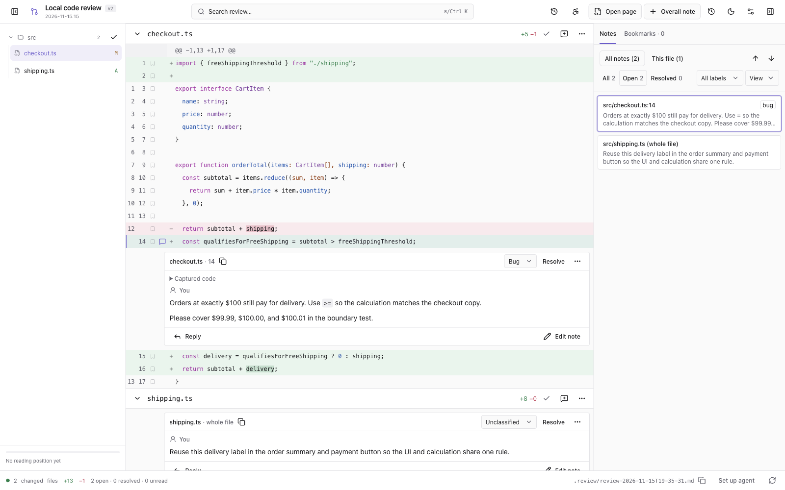
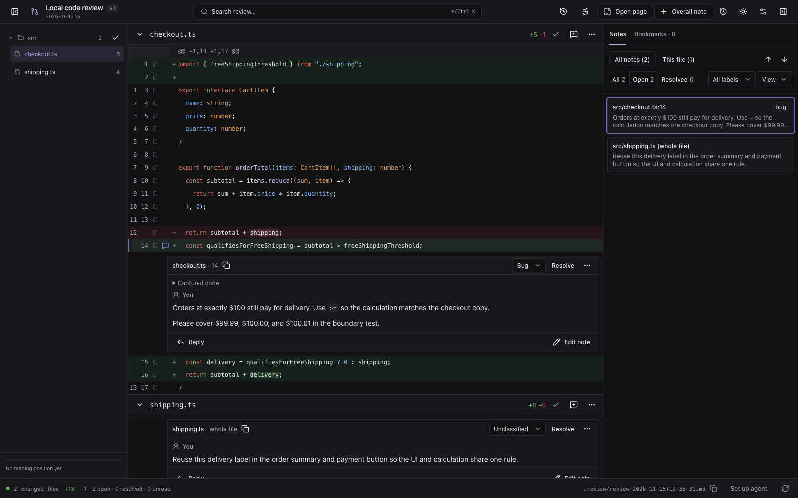
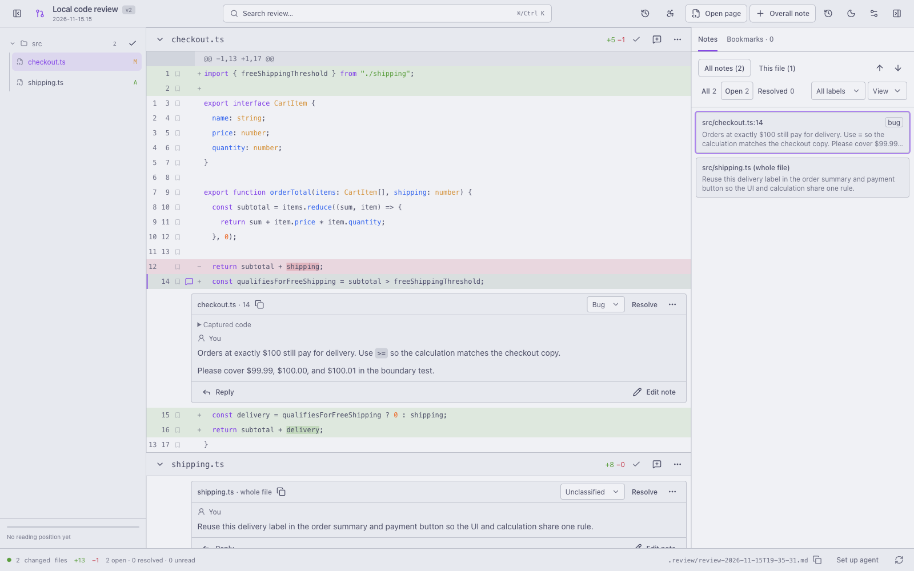
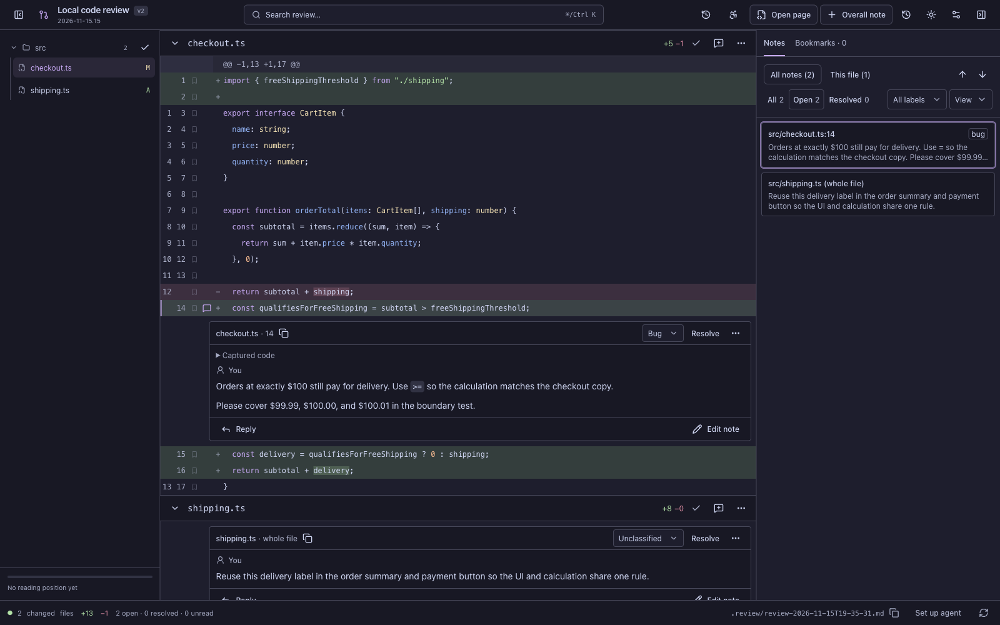
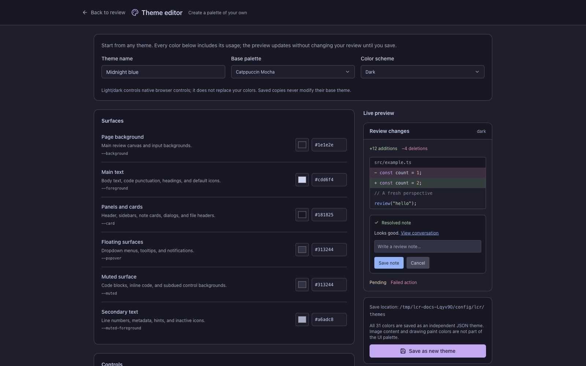

# Review workflow

This guide describes the v2 branch. See the [README](../README.md) for installation
and [agent connections](agent-connections.md) for ACP setup.

## Choose changes

```sh
lcr                         # Working tree, staged, and untracked changes vs HEAD
lcr --staged                # Index only
lcr main...HEAD             # Committed branch changes
lcr origin/main -- src/     # Compare one path
lcr --id checkout           # Continue a named conversation
lcr --port 0 --no-open      # Pick a free port and open the printed URL manually
```

Explicit Git arguments pass through to `git diff`. A named review continues across
range or branch changes; otherwise the range, branch, and base identify it.
Settings are read from the user's XDG configuration, never a discovered repository
config. `--no-agent` bypasses the default ACP profile.

Reading changes leaves the Git index untouched, including unstaged deletions and
existing intent-to-add entries. Untracked files are included using a private index.

## Read and comment

Scroll through the entire review in one pane; files follow one another in sidebar
order. The sidebar highlights the file under the top of the pane. Its links jump
within that continuous review instead of replacing it.
Only a small window of code and notes is mounted, even for very large diffs.
File visibility controls appear on row hover or keyboard focus without reserving
a separate column.

Drag the vertical dividers or their full grip handles to resize the file sidebar
and conversation pane. Focused dividers also accept arrow keys and Home/End;
double-click resets that pane's width. Widths and panel visibility survive reloads
and hide/show toggles, including when the URL points to a note. Restoring that
location does not reopen a hidden conversation pane; actively following another
note link can still reveal it. Resizing keeps the current code position and open draft;
narrow screens retain file and conversation drawers. Below 1280px the
file sidebar opens from the header toggle; below 960px the notes pane also becomes a drawer.
Inline panes keep at least 480px for the diff instead of squeezing code behind
sidebar controls. Either divider works with the opposite sidebar hidden.

The right sidebar has **Notes** and **Bookmarks** tabs. Bookmark a code line from
its gutter; use the Bookmarks tab or Alt ↑/↓ to return to saved places. Switching
tabs keeps conversation drafts and list positions intact.
Previous/next note navigation stays within the selected file scope, triage, and
open/resolved filters.

Panel toggles smoothly expand or collapse the layout, keeping sidebar content at
its expanded width instead of rewrapping it during the animation. Newly arriving
notes/replies use brief, subtle animations. Dragging stays immediate; reduced-motion
preferences disable these animations.

File headers stay visible while reading their code. Their history badge opens
earlier-review notes without adding another header row. Collapse a file with its
chevron, or mark it **Viewed** to collapse it and record progress. A navigation jump
reopens it while keeping its viewed mark; a changed file becomes unviewed. Gutter
arrows reveal omitted context above or below. Middle gaps offer both directions,
or one unfold control when the batches would meet. The batch size is configurable
in Settings. **File actions → Fold removed lines** replaces deletions with
expandable markers; a run containing a note stays open.

Notes appear inline beside their subject; the conversation pane defaults to a
compact index rather than duplicating every thread. **In diff** jumps to the
note, reopening its file. The pane preserves your reading position when notes or
code change. Incoming diff updates wait until an open editor closes.
Creating or saving a note does not navigate to it. Scroll to an offscreen editor
yourself; explicit **In diff**, note links, and navigation still jump to their targets.
The note nearest the visible top of the diff is highlighted in the sidebar.
Captured code uses the same disclosure in drafts, inline notes, and full sidebar
conversations. It starts closed; **Settings → Expand captured code in notes by
default** opens it by default. Each disclosure can still be toggled independently.
Expanded captures wrap long lines and grow with their content, without a nested scrollbar.
Commented code ranges have a subtle edge marker and tint, preserving added/removed
line colors.
Note indicators stay in a fixed gutter slot; saving a note never shifts or
inserts content into the source line.
Line-number columns fit the largest old/new line numbers in each file, including
rows outside the virtualized viewport. They grow when expanded context needs more digits.
Long code lines wrap by default. Disable **Settings → Wrap long lines** for
single-line reading; horizontal scrolling then belongs to each file's code only.
File headers, comments, and the rest of the review stay fixed horizontally.

Hover over code to highlight a commentable row and show its gutter affordance.
Click code or a line number to comment immediately, drag across lines for a range,
or drag within a line to select specific characters. Shift-click extends a range;
Alt-drag keeps normal browser text selection for copying. Comments open directly
below their subject in a compact card. Wide panes align cards with the code text;
the left inset shrinks with the diff pane's width, down to 8px in narrow panes.
Cards and editors have solid backgrounds and small corner radii;
the surrounding area matches the code pane. **Settings → Inline note width →
Full width** removes the compact width cap. The choice survives reloads and also
applies to pinned file drafts. Locations and agent outcomes share the identity row.
File-level draft cards remain pinned below their file header while they fit the pane;
long drafts grow in the normal reading flow instead of gaining an inner scrollbar.
**Cancel** clears the selected-line highlight. Re-aiming an overlapping selection
preserves your draft text and caret; an unrelated click cannot replace a dirty
draft. The file header offers a file comment; while creating it, the editor stays
below that file's pinned header as you scroll. Saved file notes, edits, replies,
and line comments scroll normally. **Overall note** toggles an editor directly
below its header button without moving your place in the diff.
Clicking or focusing elsewhere dismisses it;
reopening restores the unsaved draft. Reloading retains that draft but leaves the
popup closed until you click **Overall note**. Panel toggles sit at the two ends of
the same compact header, without a second branch/range row. Change counts and
refresh live in the footer; the copy icon beside the review path copies that path.

The editor accepts Markdown, including tables, checklists, and fenced code.
Text and previews grow with the note, without inner scrollbars. Empty editors have
no placeholder; text fields and new drawing labels have transparent backgrounds.
Typed line breaks remain visible in previews, saved notes, and replies.
The toolbar exposes every formatting action and attachment control as an icon
button, with titles on hover or keyboard focus. **Write / Preview** are icon
toggles too; narrow editors wrap the toolbar rather than hiding actions in a menu.
**Suggest change** inserts a fenced replacement for the captured lines, even when
the capture is collapsed. It keeps added and unchanged lines, drops removed lines,
and strips only diff prefixes, preserving indentation and blank lines. Deleted-only
captures use the former code as an editable starting point. Literal backticks are
protected with a longer fence.
Drop or paste files, or use **Attach file**, to attach them
directly to a note or reply (up to 12 MiB each). Files are kept beside the review
and linked relatively; external images are not loaded.
Attached images have inline thumbnails without extra framing or preview/annotate
buttons. Clicking an editable image opens its drawing editor, which also offers
the original view. Drawings retain editable shapes, text, paths, callouts and other
tools when reopened. Tools share one header; **More tools** appears only when they
cannot all fit. Tool-specific controls stay inline on wide screens and use
**Options** on narrow screens. The checkmark applies the drawing without saving the
note. Click a diff image to open the drawing editor, or drag a region to capture it
in a comment. Audio diffs have before/after players.
The pen's optional pressure/taper setting uses versioned perfect-freehand strokes.
Pen devices retain pressure samples; mouse input uses explicitly recorded simulated
pressure. Existing drawings keep their original rendering. Drawing controls use
Base UI while the scene remains Konva.

Color editing recognizes `lab()`, `lch()`, `oklab()`, `oklch()`, and supported
`color()` spaces as well as legacy literals. Literal and opacity edits retain the
source color space; using the native picker explicitly converts to sRGB.

**Save note** writes immediately. With ACP configured, **Save & ask AI** also queues
that note; **Save only** persists without dispatch. Enter saves by default;
Shift+Enter inserts a newline, and Cmd/Ctrl+Enter always saves. Settings can turn
off Enter-to-save. The editor retains failed saves and drafts across reloads;
incoming live updates do not replace their text.
Successful browser draft persistence is announced to assistive technology;
storage failures remain visible warnings.

Drafts remember their originating review. If another window switches conversations,
saving is rejected without discarding the draft; **Return to draft review** restores
its destination. A recovered draft from an older build asks you to choose its review
explicitly before saving. Concurrent lcr instances serialize Markdown updates through
a shared filesystem lock and replace complete files atomically.

**Triage** classifies a note as blocker, bug, suggestion, question, or unclassified.
It stays in the note header while reading and editing.
It persists in Markdown, imports, history, and reloads. Filter by triage separately
from resolution. Changing classification alone preserves replies, verdicts,
reviewer resolution, and queued work; it does not ask an agent to act.
Agents may classify an unclassified note from their investigation, but must keep
an existing category. Managed-agent results only classify the unchanged submitted
revision after a completed turn. Saving text from an older editor preserves a
category assigned meanwhile unless the reviewer explicitly changes classification.

AI requests show queued, running, and permission/error states on their note and
in the footer. Running work includes the agent's current activity when available.
**Settings → Enable AI answers** disables new dispatches while keeping manual note
and reply saves available. Already queued or running work is not cancelled.

Bottom-right notifications announce new agent replies and offer **View** to jump
to the note; existing replies are not announced when opening a review. Successful
note/reply saves stay silent. Disable reply notifications with **Settings → Show
new agent reply notifications**. Failed actions still report errors.

## Themes and custom colors

**Settings → Appearance → Theme** offers **Light**, **Dark**, **Catppuccin Latte**
(light), and **Catppuccin Mocha** (dark), plus your saved custom themes. Selection
is stored as `ui.theme` in your user config and survives restarts. Open pages on
the same lcr server update together. The header's light/dark shortcut switches
between Latte and Mocha when using Catppuccin, or between Light and Dark otherwise.

| Light (`light`)                                                                         | Dark (`dark`)                                                                        |
| --------------------------------------------------------------------------------------- | ------------------------------------------------------------------------------------ |
| [](review-light.png) | [](local-code-review.png) |
| **Catppuccin Latte (`catppuccin-latte`)**                                               | **Catppuccin Mocha (`catppuccin-mocha`)**                                            |
| [](catppuccin-latte.png)    | [](catppuccin-mocha.png) |

These screenshots use the same example checkout and note positions so you can
compare the palettes. Click an image for its full-size view.

Choose **Create theme** beside the selector to open a separate editor page with
the selected palette prefilled, leaving your review and note drafts in place.
Give the copy a name, choose its light/dark color scheme, and edit any of the 31
colors using a picker or a six-digit hex value. Each field explains its use:
surfaces, text, controls, status indicators, diff lines, and syntax highlighting.
The live preview stays separate from the active theme until you save. Light/dark
sets the browser color scheme; changing it does not replace your chosen colors.

[](theme-editor.png)

**Save as new theme** creates a JSON file under
`$XDG_CONFIG_HOME/lcr/themes/`, or `~/.config/lcr/themes/`, and selects it. The editor
shows the exact saved path. You can select a custom theme and create another copy
from it. Every copy has its own generated ID and complete palette; `extends`
records the base theme but does not create a live dependency or overwrite it.
Invalid colors cannot be saved, failed saves retain your edits, and leaving with
unsaved changes prompts before discarding them. Invalid theme files are reported
without hiding the built-in themes.

The palette also colors embedded review editors and live-page capture controls,
but never changes captured images, image content, or drawing paint colors.

## Continue the conversation

The conversation pane defaults to **All notes** with an **Open** state filter.
**This file** explicitly scopes the list to the current file; both scopes show
counts, and empty states distinguish an empty review from a filtered list.
**All / Open / Resolved** describe reviewer acknowledgement, not agent progress.
Agent outcomes and activity remain separate.

The label filter sits beside the select-style **View** control.
**View → Compact list / Full conversations** changes how the sidebar presents notes.
Compact rows show locations, feedback, resolution when applicable, and reply counts. Clicking a note
jumps to its inline thread, including overall notes. Notes whose files are no
longer in the diff expand individually in the sidebar; **Back to note list**
returns to the index. Finish an open conversation
editor before switching views. View preferences survive reloads.

**Resolve / Reopen** and **Note actions** sit in the compact note header.
Reply stays below the conversation, with **Edit note** at the bottom right.
The copy icon beside the note location copies its stable reference without a
success message. **Note actions** contains deletion; each editable reply has
**Reply actions**. Copying the footer's review path is silent too; copy failures
still report an error.
Your original note and replies are labeled **You**; agent replies and summaries
have a separate author icon and accent. Agent messages remain the agent's account.
Unread counts include only incoming agent messages, never your own replies.
References expand in place to show their note and conversation. Type `#` in a note
or reply to search notes by reference, file, or text. Use ↑/↓ and Enter/Tab, or click
a suggestion, to insert its reference; Escape dismisses suggestions. Type `@` to
fuzzy-search reviewed files by path or filename, never their contents. Selecting
a file inserts a Markdown reference that navigates to it, including hidden files.

Ask any coding agent to address `.review/review-<timestamp>.md`. Agent messages and
statuses appear through live updates, including replies written before a newly
created review directory is watched. With ACP, the footer opens the agent queue,
where you can pause/resume, answer permission requests, cancel tasks, and reconcile
interrupted work. A completed turn does not automatically mean a fix was applied.

Without an agent, **Set up agent** in the footer opens launch instructions.
**Settings → Agent connection** also explains OMP/Codex profiles, permissions,
model, and thinking settings. See [agent connections](agent-connections.md) for
profile examples and restart requirements.

Install the optional skill from your agent's terminal (also shown in **Settings →
Agent connection**, with a **Copy** button for the installation command):

```sh
npx skills add cjvnjde/local-code-review --skill apply-lcr
```

Then ask “Apply the newest lcr review” or use `/apply-lcr` if supported.

## Saved reviews and history

Each conversation has one timestamped Markdown file. Every mutation rereads that
file to retain current agent replies. Restarting adopts its conversation. Click
the review icon beside the app title (**New review**) to start another conversation;
the current file stays on disk. Unsaved edits must be saved or cancelled first.
The saved-review list in Settings reopens earlier reviews.

The header's history button opens observed review states from this browser's
append-only journal. Choose **Current review** or **All repository** to inspect
other conversations. It is read-only and can be exported as JSON. History remains
after a note is deleted; it cannot record changes while no page is listening.

**Review rounds** compares the checkout with an immutable baseline captured at an
agent handoff, or manually before work starts—even before the first saved note.
Review actual added, changed, removed, renamed, and binary files plus affected
conversations. **Verify reviewed changes** records reviewer verification separately
from task completion, agent verdict, and note resolution. Later checkout changes
make it stale. Incomplete or unavailable evidence cannot be verified.

At most 32 rounds remain active. Explicitly archive older rounds to free capacity;
their snapshots and verification remain inspectable under **Archived**. Snapshots
are bounded to 4,000 files, 256 KiB per file, and 8 MiB of retained content. They
contain repository content: keep the review output private.

## Attach on-demand context

Existing saved context links remain compatible with the `apply-lcr` skill and
`lcr context`. Web capture context bundles, selected HTML, and full-page screenshots
with HTML/CSS/JS sources are enabled by default. **Settings → Capture context** can
disable them. Full-page source is raw text evidence and can include hidden data or
secrets; privacy-region captures omit it. Context stays local; use the capture's
context ID or `context/<id>/manifest.json` when asking an agent to inspect it.
Context lives under nested **Capture details → Additional context** disclosures.
**Read text** expands or collapses a part without a nested scroll area; large
parts load in chunks. Opening the inventory does not load every payload.
New arbitrary-file attachments use ordinary relative links instead of a separate
context form.

Capture bundles include bounded layout/CSS provenance, browser-state hints, and
checkout identity. Recent interaction/failure metadata is separately opt-in;
disabling it clears the live recording buffers. Screenshots are not redacted.
See [web capture context](web-ui.md#context) for evidence scopes and privacy limits.

Agents receive a compact discovery inventory and can retrieve only a captured
target, CSS property, event window, or JSON subtree. `lcr context --help` describes
the offline filters. All retrieval uses saved evidence; it does not query the
current page or silently replace an unavailable capture.

## Navigate a large review

Bookmark lines to revisit them in the sidebar. Bookmarks survive a reload within
that tab and are isolated to the current repository/read. The sidebar's progress
block shows the saved reading file; click it to return to that position, or hover
or focus it to see the viewed percentage and full file path. The settled manual
reading position stays in this browser across reloads; programmatic file jumps do
not replace it. The centered header search (Cmd/Ctrl+K) fuzzy-searches the complete
review: filenames, hidden and virtualized code, notes, replies, and captured context.
Typing shows inline suggestions without replacing the diff. Click a suggestion
to reveal its file and jump to its subject. Enter opens advanced search with
result-type filters and added/removed/context code facets; non-code results remain
available. Its top-right × or Escape closes it. Arrow keys navigate suggestions
without taking the text caret away from the search input.

Alt+J/K steps through notes, Alt+Up/Down through bookmarks, and Alt+C switches the
all-notes view. J/K also steps while viewing all notes. Typing in an editor keeps
these review shortcuts inactive. Settings control automatic viewed tracking,
backtracking, file hide patterns, removed-line folding, context expansion, editor
choice, line-number gutter visibility, Enter-to-save, and earlier-review notes.
Preferences changed in Settings persist under `ui` in
`$XDG_CONFIG_HOME/lcr/config.json`, or `~/.config/lcr/config.json` when XDG is unset.
Startup options and relative ACP profile paths are retained.

**Resolve** acknowledges any saved note in this browser, even without an agent.
The **Resolved** filter brings it back; **Reopen** reverses the acknowledgement.
New replies and conversation revisions reopen it automatically. Resolution does
not change the verdict in Markdown. Notes from earlier reviews can be inspected
and continued with their original conversation retained. Deletion asks inline.
